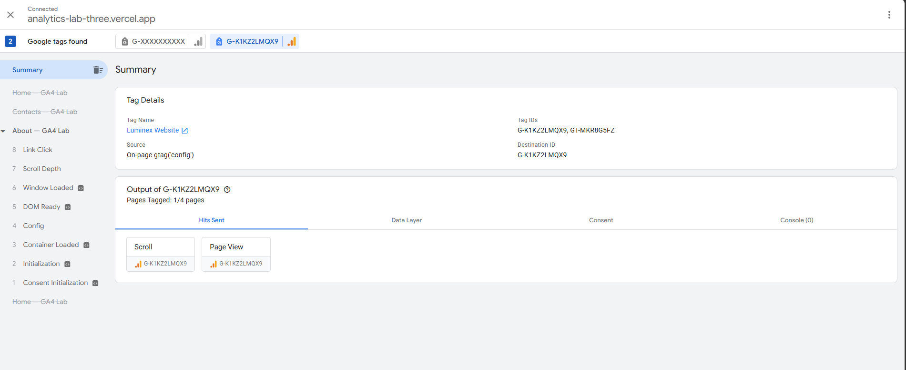
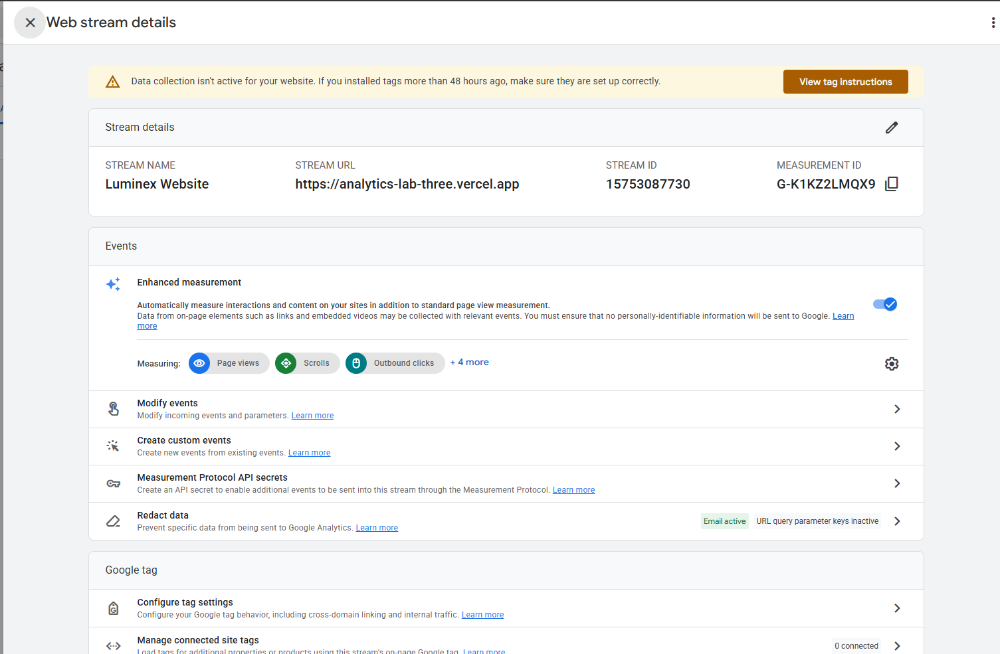
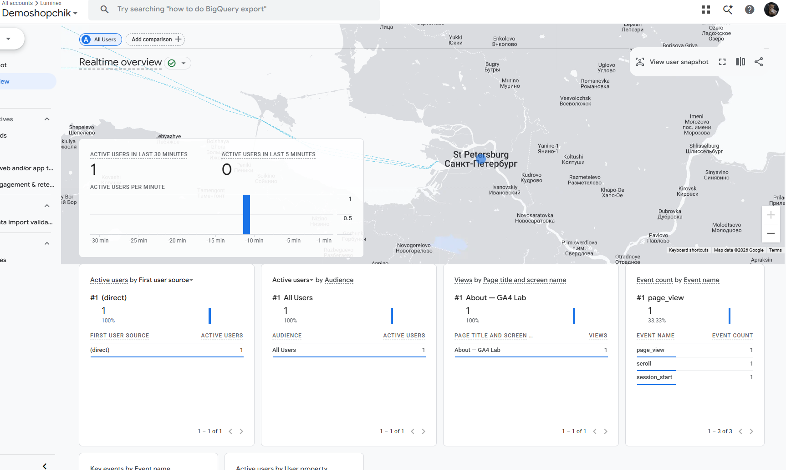
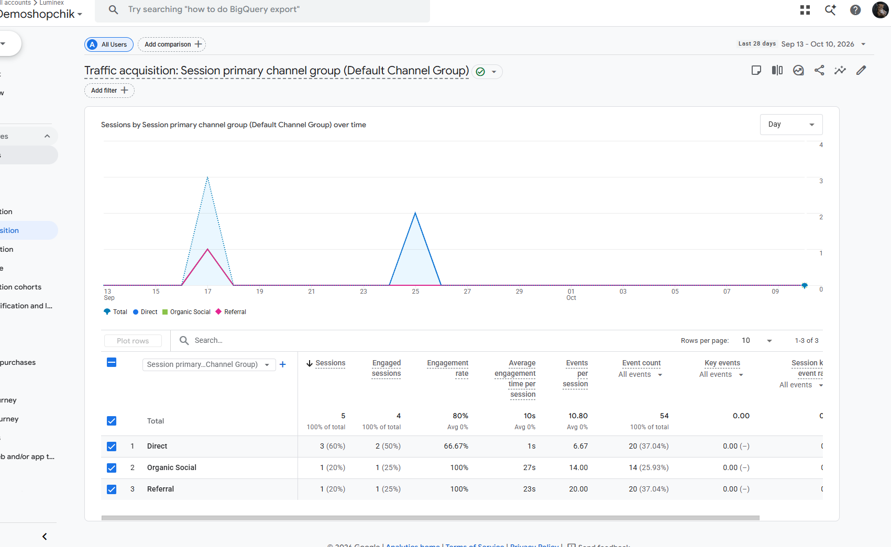
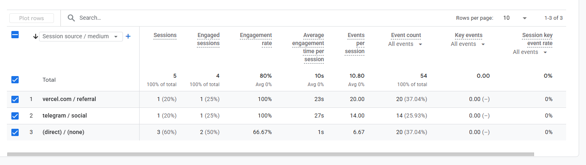

# Домашняя работа № 3 · Тег на сайте, источник и отчёты GA4

**Дисциплина:** ОП.03 «Информационные технологии»

| Поле | Значение |
|---|---|
| Фамилия, имя, отчество | Геращенко Ксения Игоревна |
| Группа | РПО2-9\3 |
| Номер работы | 3 |
| Тема работы | Установка Google Tag, источник перехода и отчёты GA4 |
| Дата сдачи | 11.10.2026 |
| Ветка | `hw-03` |

---

## 1. Мой сайт и мой ресурс

| Поле | Значение |
|---|---|
| Адрес репозитория сайта | https://github.com/sdfpzxc/information-technology |
| Публичный адрес сайта | https://github.com/sdfpzxc/analytics_lab |
| Статус публикации | READY |
| Analytics Account | https://analytics.google.com/analytics/web/?utm_source=OGB&utm_medium=app&authuser=0#/a407479606p553494829/reports/intelligenthome |
| Property | Demoshopik (GA4) |
| Stream name | Demoshopik Web |
| Website URL в потоке | https://analytics-lab-three.vercel.app |
| Measurement ID (`G-`) | G-K1KZ2LMQX9 |
| Страницы с тегом | index.html, about.html, contacts.html |

Тег ставится на каждую страницу по одному разу: две копии дают двойные
события.

## 2. Тег установлен

**Результат проверки из инструкции тега:**

>





## 3. События доходят до аналитики

| Поле | Значение |
|---|---|
| Дата и время проверки | 11.10.2026 |
| Какие страницы открывали | /index.html, /about.html, /contacts.html |
| Какие события появились в Realtime | page_view, scroll, session_start |
| Число активных пользователей в момент проверки | 1 |



## 4. Источник перехода определился

Ссылка собирается с метками `utm_source`, `utm_medium`, `utm_campaign`
и открывается на своём сайте.

**Ссылка целиком:**

```
https://analytics-lab-three.vercel.app/?utm_source=telegram&utm_medium=social&utm_campaign=hw03_test
```

| Поле | Значение |
|---|---|
| Где в GA4 виден источник | Отчёты → Привлечение → Приобретение трафика → «Источник/канал трафика» |
| Какое значение источника показал GA4 | telegram |
| Совпадает с `utm_source` из ссылки | да |



Источник и кампания из UTM в отчёте Realtime не показываются: эти измерения
вычисляются при обработке данных. Если в Realtime источника нет, смотрите
отчёт по источникам трафика в разделе «Отчёты».

## 5. Статистика на странице «Отчёты»

| Показатель | Значение | Период |
|---|---|---|
| Пользователи | 2 | 10.10.2026 – 11.10.2026 |
| Сеансы | 5 | 10.10.2026 – 11.10.2026 |
| События | 54 | 10.10.2026 – 11.10.2026 |
| Самое частое событие | 20 page_view | 10.10.2026 – 11.10.2026 |



**Что видно по этим числам** (2–3 предложения):

> Сеансов больше, чем пользователей, — значит, часть посетителей возвращалась
> на сайт или открывала его повторно. Наибольшая доля событий приходится на
> page_view, то есть трафик в основном просмотровый, без активных действий.
> Средняя вовлечённость пока низкая, поэтому стоит добавить внутренние ссылки
> между страницами.

## 6. Что не получилось

Если какой-то шаг не заработал, напишите какой, какое сообщение показал сервис
и что было проверено по таблице из `README.md`. Незаполненный раздел означает,
что всё получилось.

>

## 7. Использование ИИ

Тег вы устанавливаете, проверяете и снимаете кадры сами. ИИ допускается
для формулировок и оформления.

| Вопрос | Ответ |
|---|---|
| Что сделано самостоятельно | мысли, скрины, оформление |
| Что спрошено у модели | подсказки |
| Что после этого изменено | оформление |
