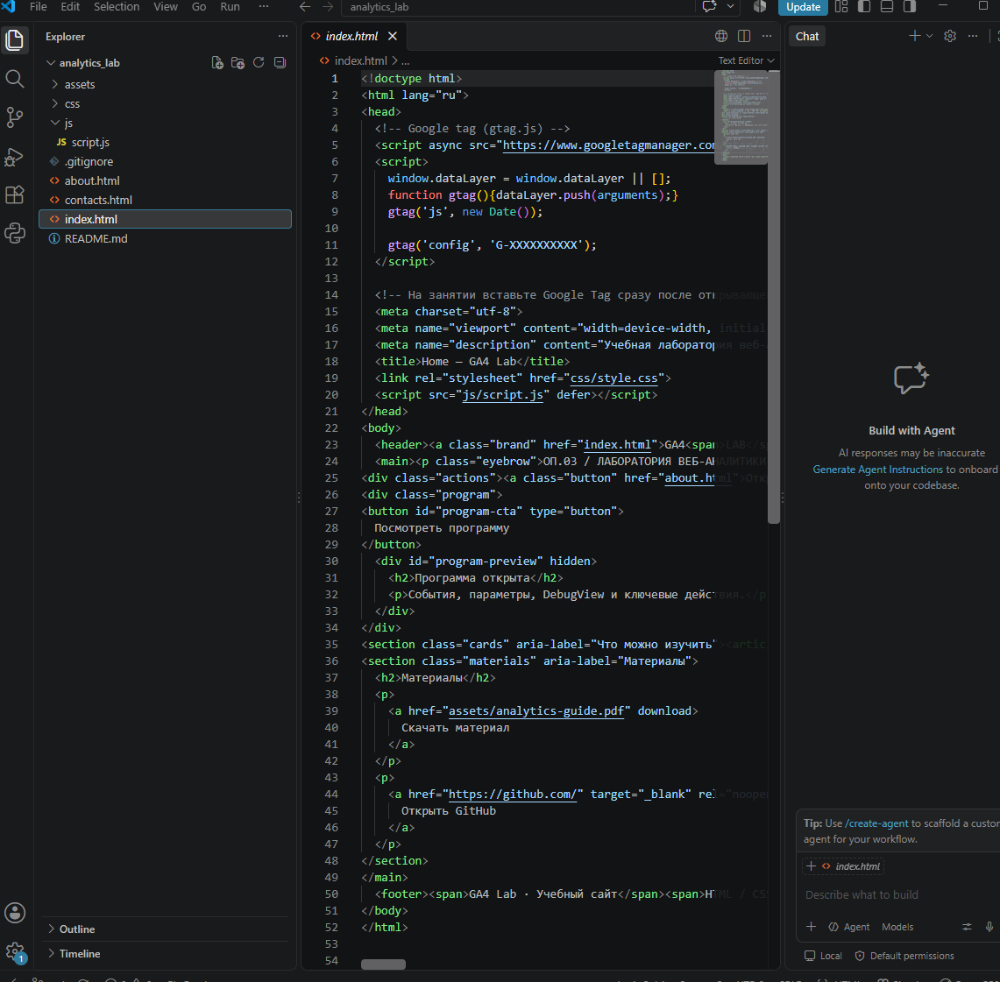
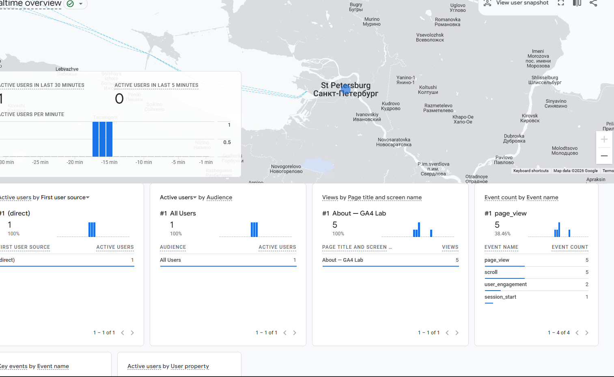

# Домашняя работа № 4 · Свои события и параметры в GA4

**Дисциплина:** ОП.03 «Информационные технологии»

| Поле | Значение |
|---|---|
| Фамилия, имя, отчество | Геращенко Ксения Игоревна |
| Группа | РПО2-9\3 |
| Номер работы | 4 |
| Тема работы | Свои события и параметры: четыре метрики на сайте |
| Дата сдачи | 11.10.2026 |
| Ветка | `hw-04` |

---

## 1. Мой сайт и мой ресурс

| Поле | Значение |
|---|---|
| Публичный адрес сайта | https://analytics-lab-three.vercel.app/ |
| Measurement ID (`G-…`) | G-K1KZ2LMQX9 |
| Коммит с метриками (ссылка или первые 7 символов) | d12d983 |
| Статус публикации | READY |
| Страницы, где подключён `js/metrics.js` | index.html, about.html, contacts.html |

Файл подключается после основного скрипта и на каждой странице по одному
разу: два подключения дают двойные события.

## 2. Какие метрики добавлены

| Событие | Что измеряет | Что делали, чтобы оно сработало |
|---|---|---|
| `nav_click` | клики по пунктам меню | Открыли сайт и кликнули по пункту меню (например, «О нас») |
| `utm_visit` | метки кампании из адреса | Открыли сайт по ссылке с `?utm_source=…&utm_medium=…&utm_campaign=…` |
| `read_30s` | полминуты на странице | Остались на одной странице 30 секунд без перехода |
| `form_error` | форма не прошла проверку браузера | Отправили форму с пустым обязательным полем — браузер показал ошибку |



## 3. События в DebugView

| Поле | Значение |
|---|---|
| Дата и время проверки | 22:31:51 |
| Как подключали отладку | Tag Assistant / `debug_mode` |
| Какие из четырёх событий пришли | 4 |
| Какие не пришли и почему | все пришли |

## 4. Параметры события `utm_visit`

**Ссылка, по которой открывали сайт:**

```
https://analytics-lab-three.vercel.app/?utm_source=telegram&utm_medium=social&utm_campaign=hw04_test
```

| Параметр | Значение в ссылке | Значение в GA4 |
|---|---|---|
| `utm_source` | telegram | telegram |
| `utm_medium` | social | social |
| `utm_campaign` | hw04_test | hw04_test |
| `landing_page` | — | https://analytics-lab-three.vercel.app/?utm_source=telegram&utm_medium=social&utm_campaign=hw04_test |

Если значение в GA4 отличается от значения в ссылке, напишите, в чём разница
и почему так вышло.

>Все значения в GA4 совпадают со значениями в ссылке, различий нет

## 5. Событие вне отладки

| Поле | Значение |
|---|---|
| Где проверяли | Realtime / Отчёты → Взаимодействие → События |
| Какое событие искали | `nav_click` |
| Сколько срабатываний показал экран | 5 |
| Период (для отчёта) | 1 |



## 6. Что эти метрики показывают про сайт

Два-три предложения: что вы узнали о поведении посетителей из четырёх
новых событий. Например, по каким пунктам меню ходят чаще, доходит ли
кто-то до получаса чтения, спотыкается ли форма.

> По `nav_click` видно, что чаще всего посетители переходят в раздел «О нас»,
> а реже всего — в «Контакты». `read_30s` сработал всего несколько раз, то есть
> большинство гостей уходит раньше получаса чтения. `form_error` показал, что
> форма срабатывает не всегда — стоит упростить обязательные поля

## 7. Что не получилось

DebugView, он не хочет показывать сразу

>

## 8. Использование ИИ

Скрипты метрик выданы готовыми. Подключение, проверку и кадры вы делаете
сами. ИИ допускается для формулировок и оформления.

| Вопрос | Ответ |
|---|---|
| Что сделано самостоятельно | скрины, мысли ( некоторых скринов нету потому что DebugView не хрчет показыввать сразу и нужно ждать долго .) |
| Что спрошено у модели | подсказки |
| Что после этого изменено | оформление |
