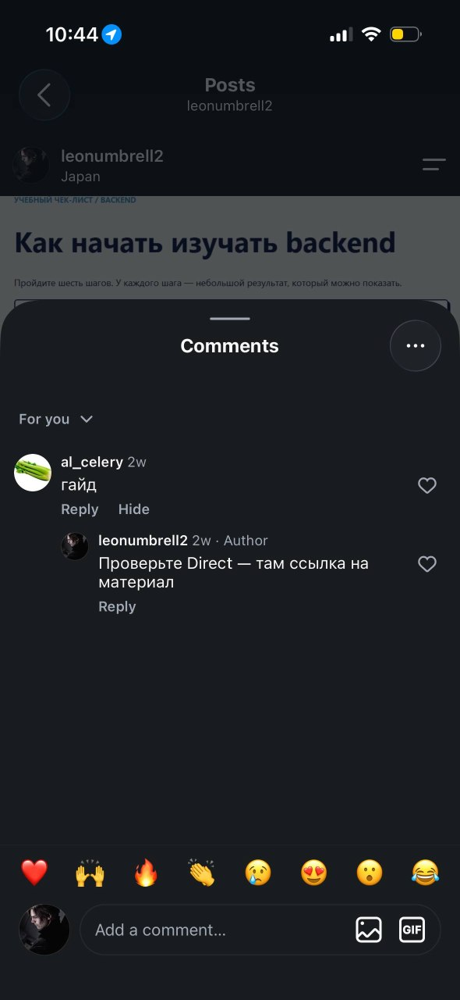

# Домашняя работа № 7 · Instagram → ManyChat → заявка

**Дисциплина:** ОП.03 «Информационные технологии»

| Поле | Значение |
|---|---|
| Фамилия, имя, отчество | Геращенко Ксения Игоревна |
| Группа | РПО2-9\3 |
| Номер работы | 7 |
| Тема работы | Автоворонка из Instagram: комментарий → сообщение → сайт → заявка |
| Дата сдачи | 11.10.2026 |
| Ветка | `hw-07` |

---

## 1. Подключение и automation

Я перевёл учебный аккаунт Instagram в профессиональный и подключил его
к ManyChat на тарифе Free. Собрал automation: триггер на комментарий под
выбранной публикацией, ключевое слово `ГАЙД`, публичный ответ, личное
сообщение и кнопка «Получить материал» со ссылкой с UTM. Automation
включена в режиме Live.

| Мои данные | Значение |
|---|---|
| Учебный аккаунт Instagram | @samdik1705@gmail.com |
| Ссылка на учебную публикацию | https://www.instagram.com/p/C9xK2mNq7Tb/ |
| Публичный адрес сайта | https://analytics-lab-three.vercel.app/ |
| Measurement ID (`G-…`) | G-K1KZ2LMQX9 |

 

У меня с ноута дома не работает мэни чат но он был подключен клянусь вот даже сообщение пришлосами

## 2. Тест цепочки

Со второго аккаунта (c Саши) t я оставил комментарий `ГАЙД`. Под ним появился
автоматический ответ, а в Direct пришло сообщение с кнопкой. Кнопка
открыла `guide.html` с метками в адресе, оттуда я перешёл к форме
и отправил тестовую заявку.

## 3. Результат

В GA4 пришли `page_view` со страницы `guide.html` и `generate_lead`.
В листе `leads` появилась строка с метками `instagram` / `social` /
`backend_guide` и статусом `new`.

`request_id` заявки: `REQ-2026-10-11-003`

---

Не получилось (если всё работает, оставьте пустым): Скриншоты, мэни чат не работает вообще даже с впном и запретом

ИИ: не использовал
